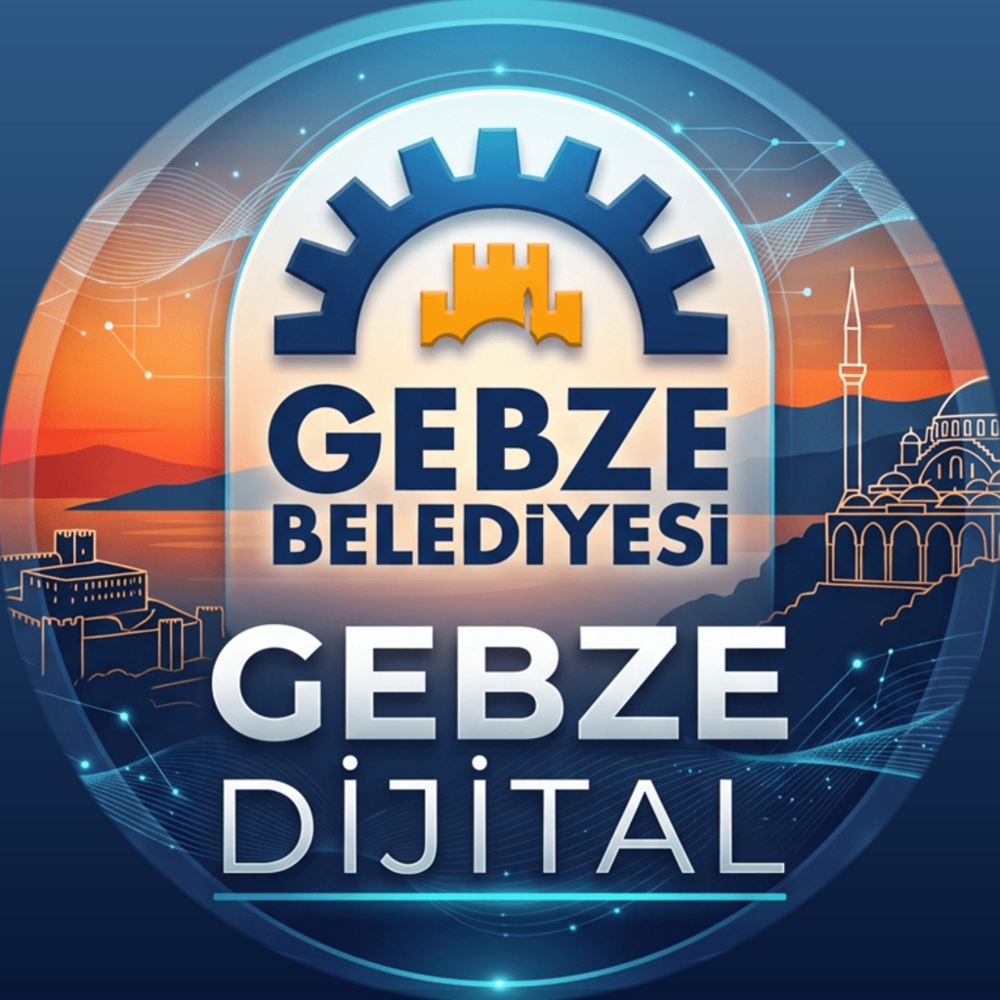
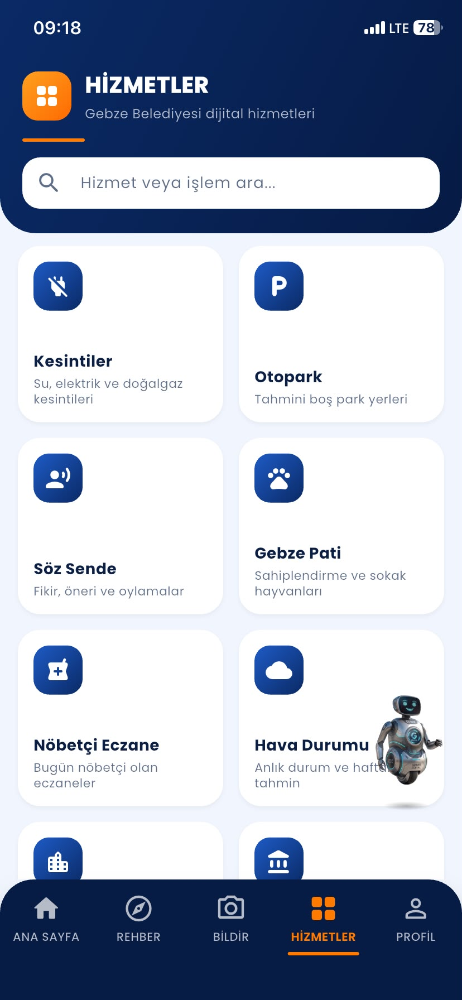
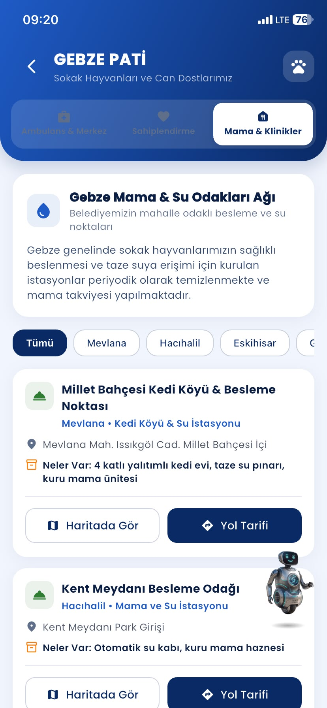

<p align="center">
  
</p>

<h1 align="center">Gebze Dijital — Akıllı Kent & Vatandaş Platformu</h1>

<p align="center">
  <b>Gebze Belediyesi</b> için geliştirilmiş modern, yapay zekâ destekli, çok dilli mobil vatandaş uygulaması ve gerçek zamanlı web yönetim portalı.
</p>

<p align="center">
  
  
  
  
  
  
  
  
</p>

---

## 📑 İçindekiler
1. [Proje Özeti ve Vizyon](#-proje-özeti-ve-vizyon)
2. [Öne Çıkan Temel Özellikler](#-öne-çıkan-temel-özellikler)
3. [📱 Mobil Uygulama Ekranları ve Modüller (35 Ekran)](#-mobil-uygulama-ekranları-ve-modüller)
   - [3.1 Ana Sayfa, Karşılama ve Hızlı Erişim](#31-ana-sayfa-karşılama-ve-hızlı-erişim)
   - [3.2 Şehir Rehberi ve Hizmet Noktaları](#32-şehir-rehberi-ve-hizmet-noktaları)
   - [3.3 Gebze'yi Keşfet (Tarih, Lezzet, Doğa ve Kültür)](#33-gebzeyi-keşfet-tarih-lezzet-doğa-ve-kültür)
   - [3.4 Parklar, Pazarlar ve Sosyal Tesisler](#34-parklar-pazarlar-ve-sosyal-tesisler)
   - [3.5 Eğitim, Kültür ve Mezarlık Hizmetleri](#35-eğitim-kültür-ve-mezarlık-hizmetleri)
   - [3.6 Can Dostlarımız: Gebze Pati & Sokak Hayvanları Ağı](#36-can-dostlarımız-gebze-pati--sokak-hayvanları-ağı)
   - [3.7 Acil Durum, Afet Toplanma ve İhbar Hatları](#37-acil-durum-afet-toplanma-ve-ihbar-hatları)
   - [3.8 Akıllı Otopark Doluluk ve Tahmin Sistemi](#38-akıllı-otopark-doluluk-ve-tahmin-sistemi)
   - [3.9 Söz Sende: Demokratik Katılım ve Kamuoyu Yoklamaları](#39-söz-sende-demokratik-katılım-ve-kamuoyu-yoklamaları)
   - [3.10 Canlı Hava Durumu, Nöbetçi Eczaneler ve Saha Çalışmaları](#310-canlı-hava-durumu-nöbetçi-eczaneler-ve-saha-çalışmaları)
   - [3.11 E-Belediye ve Çözüm Merkezi Portalı](#311-e-belediye-ve-çözüm-merkezi-portalı)
   - [3.12 Yapay Zekâ Destekli Şehir Asistanı (Bot82 Chatbot)](#312-yapay-zekâ-destekli-şehir-asistanı-bot82-chatbot)
   - [3.13 Kullanıcı Profili, Bildirim ve Mahalle Tercihleri](#313-kullanıcı-profili-bildirim-ve-mahalle-tercihleri)
   - [3.14 Çoklu Dil Desteği (Türkçe, İngilizce, Arapça RTL)](#314-çoklu-dil-desteği-türkçe-ingilizce-arapça-rtl)
   - [3.15 Gece Modu (Dark Mode) ve Erişilebilirlik](#315-gece-modu-dark-mode-ve-erişilebilirlik)
   - [3.16 Güvenli Giriş, Üyelik ve Misafir (Guest) Akışı](#316-güvenli-giriş-üyelik-ve-misafir-guest-akışı)
4. [🖥️ Yönetim Paneli (Admin Portal) Ekranları (18 Ekran)](#-yönetim-paneli-admin-portal-ekranları)
   - [4.1 Vatandaş Talepleri (Çek & Gönder) Yönetimi](#41-vatandaş-talepleri-çek--gönder-yönetimi)
   - [4.2 Vatandaş Önerileri & Moderasyon Süreci](#42-vatandaş-önerileri--moderasyon-süreci)
   - [4.3 Anket ve Kamuoyu Oylamaları Başlatma](#43-anket-ve-kamuoyu-oylamaları-başlatma)
   - [4.4 Canlı Haber ve Duyuru Yayını](#44-canlı-haber-ve-duyuru-yayını)
   - [4.5 Kültür ve Sanat Etkinlik Programı Yönetimi](#45-kültür-ve-sanat-etkinlik-programı-yönetimi)
   - [4.6 Anlık Push Bildirim ve Acil Duyuru Yayını](#46-anlık-push-bildirim-ve-acil-duyuru-yayını)
   - [4.7 Otopark Kapasite ve Canlı Doluluk Yönetimi](#47-otopark-kapasite-ve-canlı-doluluk-yönetimi)
   - [4.8 Planlı Kesintiler (İSU, SEDAŞ, PALGAZ)](#48-planlı-kesintiler-isu-sedaş-palgaz)
   - [4.9 Mahalle Saha Çalışmaları ve Yol Bakım Takibi](#49-mahalle-saha-çalışmaları-ve-yol-bakım-takibi)
   - [4.10 Nöbetçi Eczaneler Yönetimi](#410-nöbetçi-eczaneler-yönetimi)
   - [4.11 Afet & Acil Toplanma Alanları Envanteri](#411-afet--acil-toplanma-alanları-envanteri)
   - [4.12 Şehir Rehberi Kurumsal Kayıt Yönetimi](#412-şehir-rehberi-kurumsal-kayıt-yönetimi)
   - [4.13 Tarihi ve Gezilecek Mekanlar Yönetimi](#413-tarihi-ve-gezilecek-mekanlar-yönetimi)
   - [4.14 Yöresel Lezzetler (Gastronomi) Yönetimi](#414-yöresel-lezzetler-gastronomi-yönetimi)
   - [4.15 Doğa Yürüyüşü ve Piknik Rotaları](#415-doğa-yürüyüşü-ve-piknik-rotaları)
   - [4.16 Belediye Kreş ve Gündüz Bakımevleri](#416-belediye-kreş-ve-gündüz-bakımevleri)
   - [4.17 Kayıtlı Vatandaşlar (Kullanıcı Listesi)](#417-kayıtlı-vatandaşlar-kullanıcı-listesi)
   - [4.18 Vatandaş Hesap Yönetimi ve Doğrulama Detayı](#418-vatandaş-hesap-yönetimi-ve-doğrulama-detayı)
5. [🏗️ Sistem Mimarisi ve Teknoloji Yığını](#️-sistem-mimarisi-ve-teknoloji-yığını)
6. [🚀 Kurulum ve Çalıştırma](#-kurulum-ve-çalıştırma)
7. [🧪 Testler ve Kod Kalitesi](#-testler-ve-kod-kalitesi)

---

## 📌 Proje Özeti ve Vizyon

**Gebze Dijital**, Gebze Belediyesi'nin vatandaşlarına sunduğu tüm belediyecilik hizmetlerini tek bir çatı altında toplayan, interaktif, modern ve erişilebilir yeni nesil bir akıllı şehir ekosistemidir. 

Proje iki ana bacaktan oluşmaktadır:
1. **Mobil Vatandaş Uygulaması (Flutter & Riverpod)**: iOS ve Android platformlarında çalışan, canlı hava durumu, etkinlikler, nöbetçi eczaneler, otopark dolulukları, kentsel anketler, şikayet bildirme, rehber ve yapay zekâ asistanı içeren son kullanıcı deneyimi.
2. **Web Yönetim Portalı (Admin Dashboard)**: Belediyenin ilgili müdürlüklerinin ve yöneticilerinin sahayı anlık olarak yönetebildiği, canlı bildirim gönderebildiği, gelen vatandaş taleplerini inceleyip çözebildiği web yönetim kokpiti.

---

## 🌟 Öne Çıkan Temel Özellikler

- **🤖 Gebze Asistanı (Bot82 Chatbot)**: Vatandaşların belediye hizmetleri hakkında 7/24 doğal dilde bilgi alabildiği, aradığı hizmet sayfasına tek dokunuşla yönlendirildiği kural ve niyet (intent) tabanlı yapay zekâ asistanı.
- **🌍 3 Dilde Yerelleştirme**: Türkçe (TR), İngilizce (EN) ve tam sağdan-sola düzeniyle (RTL) Arapça (AR) dil desteği.
- **♿ Erişilebilirlik Odaklı Arayüz**: Yaşlı veya az gören vatandaşlarımız için geliştirilen tek tuşla **Büyük Yazı Tipi Modu** ve göz yormayan **Koyu Tema (Dark Mode)**.
- **🗳️ Söz Sende (Katılımcı Demokrasi)**: Belediyenin kentsel projeleri için açtığı anketlere katılma ve vatandaşların kendi mahalleleri için fikir paylaşıp destek toplayabildiği öneri mekanizması.
- **🅿️ Akıllı Otopark Doluluk Algoritması**: İlçe genelindeki açık ve katlı otoparkların doluluk oranlarını ve boş yerlerini istatistiki modellerle canlı sunan sistem.
- **🚨 112 & Afet Toplanma Alanları**: Acil durumlarda tek dokunuşla arama yapabilen panik/ihbar hatları ve ilçedeki en yakın toplanma alanlarının kapasite ve donanım envanteri.
- **🐾 Gebze Pati**: Kedi köyleri, sokak hayvanları besleme odakları, mama takviyesi ve veteriner kliniklerine rota çizen hayvan dostu modül.
- **⚡ Canlı Push Bildirim Entegrasyonu**: Yönetim panelinden gönderilen duyuruların anında tüm kullanıcılara veya seçilen ilgi gruplarına (Topic) ulaştırılması.

---

## 📱 Mobil Uygulama Ekranları ve Modüller

Mobil uygulama, vatandaşların ihtiyaç duyduğu tüm bilgilere en fazla iki dokunuşla ulaşmasını sağlayacak şekilde kullanıcı odaklı bir mimariyle tasarlanmıştır.

### 3.1 Ana Sayfa, Karşılama ve Hızlı Erişim
Vatandaş uygulamayı açtığında dinamik gökyüzü manzarası, canlı meteoroloji kartı, okunmamış bildirim rozeti ve en sık kullanılan 6 modüle hızlı geçiş butonlarıyla karşılanır.

|  |  |  |
|:---:|:---:|:---:|
| **Ana Sayfa (Gündüz Modu)**<br>Hava durumu, acil erişim butonları ve yaklaşan kültür sanat etkinlikleri | **Ana Sayfa Vitrini**<br>Gebze'nin tarihi simgeleri ve belediye saha çalışmalarının canlı haber akışı | **Tüm Hizmetler Ekranı**<br>Kesintilerden patiye, eczaneden otoparka tüm belediye modülleri |

---

### 3.2 Şehir Rehberi ve Hizmet Noktaları
Gebze'deki tüm belediye birimleri, sosyal alanlar, kütüphaneler ve tesisler kategorize edilmiş rehberde sunulur.

|  |  |  |
|:---:|:---:|:---:|
| **Şehir Rehberi (Kurumsal)**<br>Etkinlikler, lokantalar, pazarlar, kütüphaneler ve spor tesisleri menüsü | **Yaklaşan Etkinlikler**<br>Çocuk sineması, tiyatro ve konser programları, tarih/saat ve resmi bağlantılar | **Belediye Tesisleri**<br>GİMER Çözüm Merkezi ve Barış Sosyal Tesisleri iletişim ve rota bilgisi |

---

### 3.3 Gebze'yi Keşfet (Tarih, Lezzet, Doğa ve Kültür)
İlçenin köklü tarihi, zengin gastronomisi ve doğa harikaları "Gebze'yi Keşfet" sekmesinde derinlemesine incelenir.

|  |  |  |
|:---:|:---:|:---:|
| **Tarihi Yerler**<br>Hünkar Çayırı, İlyasbey Camii, Eskihisar Kalesi; favorilere ekleme ve harita konumu | **Yöresel Lezzetler**<br>Tescilli Gebze Çöreği, Kocaeli Manda Yoğurdu, köken ve nerede yenir bilgisi | **Doğa & Piknik Rotaları**<br>Beylikdağı Orman Yürüyüşü, göletler ve mesire alanları yol tarifleri |

---

### 3.4 Parklar, Pazarlar ve Sosyal Tesisler
Gebzelilerin günlük hayatını kolaylaştıran pazar yerleri, sosyal restoranlar ve dinlenme parkları.

|  |  |  |
|:---:|:---:|:---:|
| **Parklar ve Kütüphaneler**<br>Güzide Gençlik Merkezi Kütüphanesi ve Eskihisar Macera Parkı tesisleri | **Kent Lokantaları (Güzide)**<br>Güzide Beylikbağı ve Kent Meydanı restoranları, güncel menü ve yol tarifi | **Kapalı Semt Pazarları**<br>Mevlana ve Tatlıkuyu pazar yerleri, kurulduğu günler ve ulaşım detayları |

---

### 3.5 Eğitim, Kültür ve Mezarlık Hizmetleri
Eğitim, sanat ve cenaze-defin gibi sosyal belediyecilik hizmetlerinin şeffaf yönetimi.

|  |  |  |  |
|:---:|:---:|:---:|:---:|
| **Spor Tesisleri**<br>Yarı Olimpik Havuz ve Güzide Sağlıklı Yaşam Merkezi | **Kültür Merkezleri**<br>Osman Hamdi Bey Kültür Merkezi ve GESMEK sanat kursları | **Mezarlık Hizmetleri**<br>Merkez Mezarlığı, Pelitli ve 7/24 Alo 188 Cenaze Hattı | **Kreş ve Atölyeler**<br>Arapçeşme Gündüz Bakımevi ve Montessori kreşleri |

---

### 3.6 Can Dostlarımız: Gebze Pati & Sokak Hayvanları Ağı
Sokak hayvanlarımızın sağlığı ve refahı için mahalle odaklı besleme ağı ve kedi köyleri haritası.

|  |  |
|:---:|:---:|
| **Gebze Pati Portalı**<br>Mama odakları, acil hayvan ambulansı ve sahiplendirme modülleri | **Mama ve Su Odakları Detayı**<br>Millet Bahçesi Kedi Köyü ve Kent Meydanı otomatik mama üniteleri haritası |

---

### 3.7 Acil Durum, Afet Toplanma ve İhbar Hatları
Olası afet veya kriz durumlarında vatandaşın hayati bilgiye ve yardım hatlarına gecikmesiz erişmesi sağlanır.

|  |
|:---:|
| **Acil Durum ve Toplanma Alanları**<br>112 Acil Çağrı, Beyaz Masa (444 1 890), AFAD (122), İSU, SEDAŞ, PALGAZ ve Zabıta tek dokunuşla arama; en yakın toplanma alanlarının mesafesi, kişi kapasitesi ve altyapı donanımları (su, elektrik, WC) |

---

### 3.8 Akıllı Otopark Doluluk ve Tahmin Sistemi
Kentsel trafiği ve otopark arama süresini azaltmak için geliştirilen yapay zekâ ve istatistiki tahmin modeli.

|  |
|:---:|
| **Akıllı Otopark Ekranı**<br>İlçe geneli ortalama doluluk oranı (%69), toplam kapasite, tahmini boş yer sayıları, parkomat tarifeleri ve navigasyon yol tarifi |

---

### 3.9 Söz Sende: Demokratik Katılım ve Kamuoyu Yoklamaları
Gebzeliler belediyenin kentsel projelerine doğrudan oy vererek karar süreçlerine dahil olur.

|  |
|:---:|
| **Söz Sende (Aktif Anketler)**<br>Cumhuriyet Meydanı yayalaştırma projesi ve mahalle spor atölyesi yoklamaları; şeffaf oy dağılımı ve "Oyunuz Kaydedildi" onayı |

---

### 3.10 Canlı Hava Durumu, Nöbetçi Eczaneler ve Saha Çalışmaları
İlçedeki anlık hava durumu, açık eczaneler ve mahalledeki yol onarım çalışmaları gerçek zamanlı olarak takip edilir.

|  |  |  |
|:---:|:---:|:---:|
| **Canlı Hava Durumu**<br>Anlık 15°C, nem, rüzgar hızı, günün saatlik tahmini ve 5 günlük hava raporu | **Nöbetçi Eczaneler**<br>Güncel nöbetçi eczaneler listesi, tek tıkla arama ve nöbete özel yol tarifi | **Mahallemde (Saha Çalışmaları)**<br>Kazı, asfaltlama, yol onarımı, sorumlu birim ve kalan gün sayacı |

---

### 3.11 E-Belediye ve Çözüm Merkezi Portalı
Belediye binasına gitmeden borç sorgulama, ödeme ve başvuru takibi yapma imkanı.

|  |  |
|:---:|:---:|
| **E-Belediye Rehberi**<br>Çözüm masası başvuru formu, başvuru takip, vergi borcu ödeme ve e-Beyan | **Belediye Haberleri**<br>Belediyenin mahalle asfaltlama ve eğitim projelerini duyuran canlı bülten |

---

### 3.12 Yapay Zekâ Destekli Şehir Asistanı (Bot82 Chatbot)
Kullanıcıların doğal dilde yönelttiği soruları anlayıp anında yanıtlayan ve ilgili hizmet sayfasına yönlendiren akıllı asistan.

|  |
|:---:|
| **Gebze Asistanı (Bot82)**<br>Su/elektrik kesintisi, nöbetçi eczane, etkinlikler ve şikayet bildirimi için doğal dil işleme ve hızlı yönlendirme çipleri |

---

### 3.13 Kullanıcı Profili, Bildirim ve Mahalle Tercihleri
Kullanıcının kimlik doğrulama durumu, ikamet ettiği mahalle, aktif önerileri ve sistem ayarları.

|  |  |
|:---:|:---:|
| **Profilim Ekranı**<br>Kişisel avatar, "Doğrulanmış" hesap rozeti, paylaşılan öneri ve destek sayıları | **Uygulama Ayarları**<br>Dil seçimi, Büyük Yazı Tipi switch'i, tema tercihi, GİM tek dokunuş çağrı butonu |

---

### 3.14 Çoklu Dil Desteği (Türkçe, İngilizce, Arapça RTL)
Uygulama, yerli ve yabancı tüm hemşehriler için tam dil uyumuna sahiptir.

|  |  |
|:---:|:---:|
| **İngilizce Dil Desteği (EN)**<br>Uluslararası ziyaretçiler için "Welcome to Gebze" tam çeviri arayüzü | **Arapça Dil Desteği (AR RTL)**<br>Arapça metinler ve sağdan sola (RTL) dönen kullanıcı deneyimi |

---

### 3.15 Gece Modu (Dark Mode) ve Erişilebilirlik
Karanlık ortamlarda gözü yormayan ve pil tasarrufu sağlayan gece modu tasarımı.

|  |  |
|:---:|:---:|
| **Koyu Tema (Dark Mode) - Üst Görünüm**<br>Koyu lacivert ve siyah paletle harmanlanmış modern gece kartları | **Koyu Tema (Dark Mode) - Etkinlikler**<br>Yüksek kontrastlı tipografi ve canlı afiş sunumu |

---

### 3.16 Güvenli Giriş, Üyelik ve Misafir (Guest) Akışı
Kullanıcılar kayıt olmadan uygulamayı misafir olarak deneyimleyebilir; kritik işlemlerde ise şık bir yetki uyarısıyla karşılanır.

|  |  |
|:---:|:---:|
| **Üye Girişi & Misafir Modu**<br>E-posta/Şifre ile giriş veya "Üye Olmadan Devam Et" misafir seçeneği | **Üyelik Gerekli (Auth Gate)**<br>Misafir modunda yetki gerektiren alanlara erişimde çıkan bilgilendirme |

---

## 🖥️ Yönetim Paneli (Admin Portal) Ekranları

Belediye yöneticileri ve saha ekipleri için tasarlanan web yönetim kokpiti, Firebase Firestore ile çift yönlü gerçek zamanlı senkronize çalışır.

### 4.1 Vatandaş Talepleri (Çek & Gönder) Yönetimi
> **Açıklama**: Vatandaşların mobil uygulama üzerinden gönderdiği fotoğraflı ve konumlu arıza/şikayet bildirimlerinin (asfalt çökmesi, kaldırım, aydınlatma, su patlağı vb.) takip edildiği, durumunun *(Beklemede, İnceleniyor, Çözüldü)* güncellendiği ve vatandaşa SMS/Push yanıtı iletildiği ana operasyon ekranı.

<p align="center">
  
</p>

---

### 4.2 Vatandaş Önerileri & Moderasyon Süreci
> **Açıklama**: Söz Sende modülünde vatandaşların kendi mahalleleri için paylaştığı önerilerin (örn. mobil kütüphane, ücretsiz ring servis, park bankı) kamuoyuna açılmadan önce yönetici onayına sunulduğu moderasyon paneli. *"Onayla ve Yayınla"* butonuyla mobilde anında tüm kullanıcılara açılır.

<p align="center">
  
</p>

---

### 4.3 Anket ve Kamuoyu Oylamaları Başlatma
> **Açıklama**: Belediye yönetiminin ilçe genelinde veya belirli bir mahalle özelinde kamuoyu yoklaması başlatabildiği ekran. Soru, detaylı açıklama, son tarih ve seçenekler girilerek anında mobil uygulamaya sunulur ve toplanan oylar canlı izlenir.

<p align="center">
  
</p>

---

### 4.4 Canlı Haber ve Duyuru Yayını
> **Açıklama**: Mobil uygulamanın ana sayfasında yer alan haber akışının yönetildiği panel. Yeni haber ekleme formunun yanı sıra *"Belediye Haberlerini Senkronize Et"* butonu ile belediyenin resmi web sitesindeki bültenleri tek tıkla uygulamaya aktarır.

<p align="center">
  
</p>

---

### 4.5 Kültür ve Sanat Etkinlik Programı Yönetimi
> **Açıklama**: Gebze Kültür Merkezi ve GESMEK salonlarında düzenlenen tiyatrolar, çocuk sinemaları, seminerler ve konserlerin aylık takvim bazında yönetildiği, afiş ve saat bilgilerinin girildiği kültür yönetim ekranı.

<p align="center">
  
</p>

---

### 4.6 Anlık Push Bildirim ve Acil Duyuru Yayını
> **Açıklama**: Firebase Cloud Messaging (FCM) altyapısı üzerinden tüm mobil cihazlara canlı bildirim gönderme konsolu. Bildirimin hedef konusu (Topic) ve tıklandığında açılacak 28 farklı uygulama sayfası seçilerek doğrudan ilgili ekrana yönlendirme yapılabilir.

<p align="center">
  
</p>

---

### 4.7 Otopark Kapasite ve Canlı Doluluk Yönetimi
> **Açıklama**: İlçedeki 9 katlı ve yol üstü otoparkın toplam 695 kapasitesinin, tahmini boş ve dolu park yerlerinin denetlendiği kontrol ekranı. Canlı doluluk butonları (-5, -1, +1, +5) ve resmi otopark senkronizasyonu ile doluluk oranları anında güncellenir.

<p align="center">
  
</p>

---

### 4.8 Planlı Kesintiler (İSU, SEDAŞ, PALGAZ)
> **Açıklama**: İSU Su Arıza, SEDAŞ Elektrik ve PALGAZ Doğalgaz kurumlarının ilçe genelindeki planlı şebeke yenileme ve boru hattı bakım kesintilerinin başlangıç-tahmini bitiş saatleriyle sisteme girildiği ve harita üzerinde sunulduğu ekran.

<p align="center">
  
</p>

---

### 4.9 Mahalle Saha Çalışmaları ve Yol Bakım Takibi
> **Açıklama**: Fen İşleri ve Temizlik İşleri Müdürlüğü'nün mahalle bazlı yürüttüğü parke taşı yenileme, asfalt serimi, kablo kanalı kazısı ve ağaç budama çalışmalarının takibi. Tamamlanan veya süresi dolan kayıtlar tek tuşla temizlenebilir.

<p align="center">
  
</p>

---

### 4.10 Nöbetçi Eczaneler Yönetimi
> **Açıklama**: İlçedeki nöbetçi eczanelerin günlük ve haftalık rotasyonunun girildiği panel. Adres, 7/24 telefon numarası ve konum bilgileri doğrulanarak mobildeki arama ve navigasyon butonları güncellenir.

<p align="center">
  
</p>

---

### 4.11 Afet & Acil Toplanma Alanları Envanteri
> **Açıklama**: Gebze'deki Alaettin Kurt Şehir Stadyumu, Gaziler Dağı ve kapalı pazarlar gibi toplanma alanlarının metrekare büyüklüğü, tahmini kişi kapasitesi ve altyapı donanımlarının (Elektrik, Su, WC) kayıt altına alındığı afet koordinasyon envanteri.

<p align="center">
  
</p>

---

### 4.12 Şehir Rehberi Kurumsal Kayıt Yönetimi
> **Açıklama**: Gebze Şehir Rehberi'nde yer alan parklar, kent lokantaları, kapalı pazarlar, kültür merkezleri, mezarlıklar ve kreşlerin iletişim bilgileri, fotoğrafları ve coğrafi koordinatlarının topluca yönetildiği ana veri tabanı ekranı.

<p align="center">
  
</p>

---

### 4.13 Tarihi ve Gezilecek Mekanlar Yönetimi
> **Açıklama**: Anibal Mezarı, Çoban Mustafa Paşa Camii ve Külliyesi, Eskihisar Kalesi, Hünkar Çayırı ve Osman Hamdi Bey Müzesi gibi tescilli tarihi mekanların fotoğrafları, tarihçeleri ve merkeze uzaklıklarının düzenlendiği ekran.

<p align="center">
  
</p>

---

### 4.14 Yöresel Lezzetler (Gastronomi) Yönetimi
> **Açıklama**: Gebze Çöreği, Kocaeli Manda Yoğurdu, Mancarlı Pide ve Höşmerim Tatlısı gibi yöresel değerlerin Osmanlı dönemine uzanan köken hikayeleri, malzeme listeleri, hazırlanış adımları ve tescilli satış noktalarının yönetildiği gastronomi paneli.

<p align="center">
  
</p>

---

### 4.15 Doğa Yürüyüşü ve Piknik Rotaları
> **Açıklama**: Beylikdağı Orman Yürüyüş Parkuru, Denizli Göleti Doğa Rotası ve Elmalıdere Şelalesi gibi mesire ve trekking rotalarının tanıtımı, bitki örtüsü ve Google Haritalar navigasyon arama parametrelerinin girildiği panel.

<p align="center">
  
</p>

---

### 4.16 Belediye Kreş ve Gündüz Bakımevleri
> **Açıklama**: Beylikbağı, Yenikent, Arapçeşme ve Şehit İlker Ağır çocuk bakım merkezlerinin kontenjan kapasitesi (85-120 kontenjan), kabul edilen yaş aralıkları (36-66 ay), kayıt durumu ve pedagog kadro bilgilerinin yönetildiği modül.

<p align="center">
  
</p>

---

### 4.17 Kayıtlı Vatandaşlar (Kullanıcı Listesi)
> **Açıklama**: Mobil uygulamaya kayıt yaptıran Gebze sakinlerinin T.C. kimlik numaraları, e-posta, telefon, ikamet mahalleleri, aktivite istatistikleri ve doğrulama durumlarının listelendiği, arama/filtreleme yapılabilen ve tek tıkla Excel (CSV) çıktısı alınabilen kullanıcı paneli.

<p align="center">
  
</p>

---

### 4.18 Vatandaş Hesap Yönetimi ve Doğrulama Detayı
> **Açıklama**: Belirli bir vatandaşın kartına tıklandığında açılan hesap yönetim modalı. Kimlik doğrulama tamamlama, Yönetici (Admin) yetkisi atama, profil bilgilerini belediye nüfus kayıtlarıyla güncelleme, cihaz bildirim izinlerini ve tema tercihlerini denetleme penceresi.

<p align="center">
  
</p>

---

## 🏗️ Sistem Mimarisi ve Teknoloji Yığını

```
┌─────────────────────────────────────────────────────────────────┐
│                    GEBZE DİJİTAL PLATFORMU                      │
├───────────────────────────────┬─────────────────────────────────┤
│    📱 Mobil Uygulama          │    💻 Web Yönetim Portalı        │
│    (Flutter & Dart)           │    (HTML5, CSS3, ES6 Vanilla JS)│
├───────────────────────────────┴─────────────────────────────────┤
│             🔥 Firebase Cloud Platform                          │
│   ├── Cloud Firestore (Gerçek Zamanlı Veritabanı & Stream)      │
│   ├── Firebase Cloud Messaging (FCM - Push Notifications)      │
│   ├── Firebase Authentication (Kullanıcı & Yönetici Girişi)     │
│   └── Firebase Storage (Talep Fotoğrafları & Dökümanlar)        │
└─────────────────────────────────────────────────────────────────┘
```

| Katman | Kullanılan Teknolojiler / Kütüphaneler |
|---|---|
| **Mobil Arayüz & Çatı** | Flutter 3.13+, Dart 3.x, Material Design 3 |
| **Durum Yönetimi (State)** | `flutter_riverpod: ^3.4.3` (StateNotifier, AsyncValue) |
| **Görsel & Ağ Önbellekleme** | `cached_network_image`, `image_picker`, `image` |
| **Harita & Konum Servisleri**| `geolocator: ^14.1.1`, `geocoding: ^5.0.0`, `url_launcher` |
| **Animasyon & Efektler** | `confetti: ^0.8.0`, Custom Curved Animations |
| **Yapay Zekâ Asistanı** | Bot82 Doğal Dil Kural ve Niyet Çıkarım Motoru (Intent Matcher) |
| **Yönetim Paneli** | Responsive Dashboard CSS, Modern Glassmorphism, Firebase JS SDK v10 |

---

## 🚀 Kurulum ve Çalıştırma

### Gereksinimler
- Flutter SDK (v3.13 veya üzeri)
- Dart SDK (v3.0 veya üzeri)
- Android Studio / Xcode (Mobil derleme için)
- Web tarayıcısı (Chrome / Edge - Yönetim paneli için)

### 1. Depoyu Klonlayın
```bash
git clone https://github.com/affanccn/gebze_dijital.git
cd gebze_dijital/gebze_dijital
```

### 2. Bağımlılıkları Yükleyin
```bash
flutter pub get
```

### 3. Mobil Uygulamayı Başlatın
```bash
# Android cihazda veya emülatörde çalıştırmak için:
flutter run

# Web üzerinde test etmek için:
flutter run -d chrome
```

### 4. Web Yönetim Panelini Başlatın
Yönetim paneli bağımsız, hafif ve sunucusuz bir yapıda tasarlanmıştır:
```bash
# admin klasörüne gidin ve herhangi bir yerel web sunucusuyla açın:
cd admin
# Örnek Python sunucusu:
python -m http.server 8080
# Veya doğrudan index.html dosyasını modern bir tarayıcıda açabilirsiniz.
```

---

## 🧪 Testler ve Kod Kalitesi

Proje, yüksek kod kalitesi, sıfır analiz uyarısı ve tam test kapsamı prensibiyle geliştirilmiştir:

```bash
# Kod analizi (0 issues garantisi)
flutter analyze

# Otomasyon ve regresyon testlerini çalıştırma (81 test)
flutter test
```

Tüm test paketleri:
- ✅ `accessibility_test.dart`: Büyük yazı tipi ve kontrast doğrulama testleri
- ✅ `chatbot_test.dart`: Bot82 niyet eşleştirici, rota ve misafir yönlendirme testleri
- ✅ `gebze_avatar_test.dart`: 15 özel profil avatarı ve görsel sağlayıcı testleri
- ✅ `notification_preferences_test.dart`: FCM konu abonelik ve filtreleme testleri
- ✅ `notification_service_test.dart`: Bildirim okundu ve sayaç testleri
- ✅ `poppins_font_test.dart`: Türkçe karakter ve yerel Poppins fontu render testleri
- ✅ `theme_mode_test.dart`: Açık ve Koyu tema renk geçişi doğrulama testleri

---

<p align="center">
  <b>Gebze Belediyesi Bilgi İşlem Müdürlüğü</b><br>
  <i>"Daha Güzel Bir Gebze İçin Dijital Çözümler"</i>
</p>
